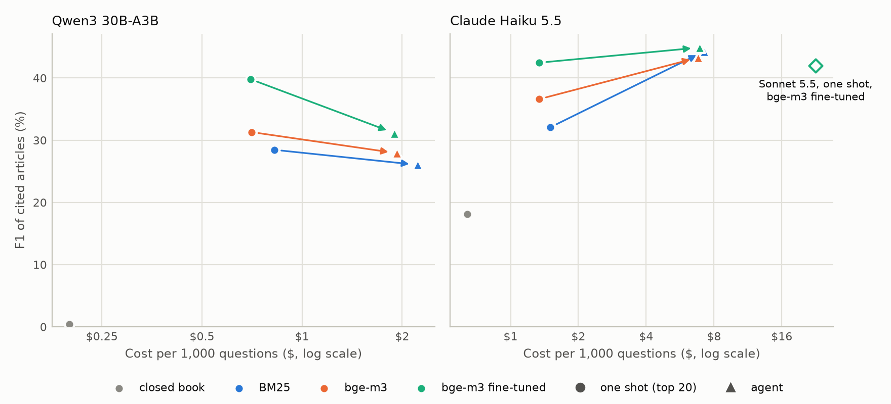
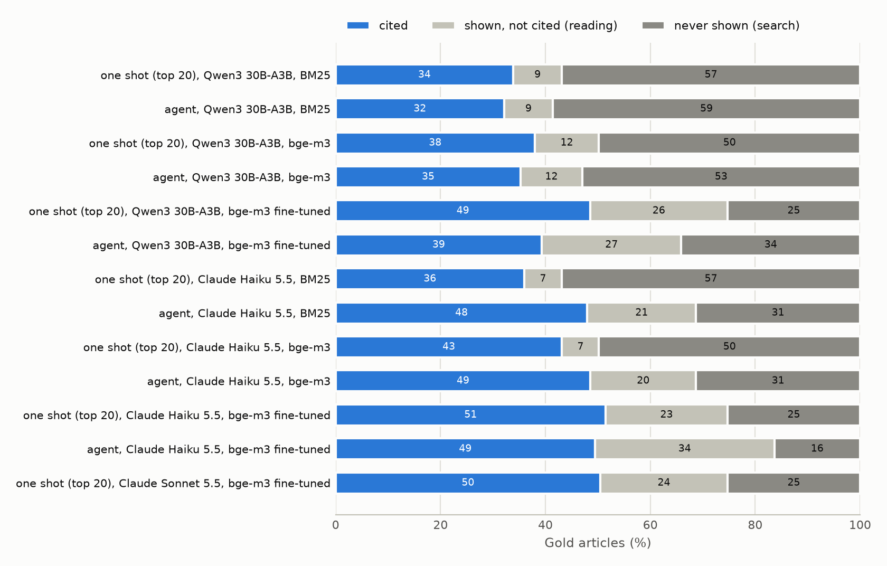

# lexsearch

**Finding the right articles of Belgian law for a citizen's question: is it worth fine-tuning the retriever,
adding a reranker, or letting an agent search several times?** Measured on [BSARD](https://huggingface.co/datasets/maastrichtlawtech/bsard)
(22,633 statutory articles, questions labelled by lawyers): every system cites article ids, which are scored
against the lawyers' lists. There is no LLM judge.

<picture>
  <source media="(prefers-color-scheme: dark)" srcset="docs/f1_vs_cost-dark.png">
  
</picture>

*Each arrow goes from one shot (the model reads the top 20 articles) to the agent (the model runs its own
searches), for the same retriever. 222 test questions.*

**In one minute:**

- **Fine-tuning the retriever pays the most.** Fine-tuned on 698 questions, bge-m3 goes from 68.3% to 88.8%
  recall@100 on the test questions, and from 40.1% to 66.9% recall@10. With a cheap model reading its top 20, it
  is the best deal: 39.8 F1 for $0.70 per 1,000 questions.
- **But it mostly learns which articles get asked about.** On the articles that were never a training label, the
  gain is +2.8 points, with an interval that includes zero. A baseline that ignores the question text and only
  ranks articles by how often they were labelled in its category reaches 58.5% recall@100, nearly BM25's 60.2%.
- **An agent fixes a weak retriever, not a strong one.** With Claude Haiku 5.5, the agent adds 12.2 F1 points
  over one shot with BM25, 6.7 with bge-m3, and 2.4 (not significant) with the fine-tuned retriever: it ends up
  at 43 to 45 whatever it searches with, for 5 times the price. A model that searches little (Qwen3 30B-A3B, 2.6
  searches per question) does worse as an agent than in one shot.
- **The ceiling is now reading the labels, not finding the articles.** With the fine-tuned retriever, a quarter
  of the gold articles are shown to the model and not cited. Claude Sonnet 5.5 reading the same 20 articles
  does no better than Haiku (−0.5 F1, 17 times the price). A good share of those misses are broad gold lists:
  a whole chapter of the criminal code for one question.

## Results

All numbers are on BSARD's 222 test questions. Every choice (retriever, hyperparameters, prompts) was made on a
dev split of 188 training questions; intervals are 95% bootstrap intervals over questions, and differences are
paired on the same questions.

### 1. Retrieval

| Retriever | R@10 | R@20 | R@100 | nDCG@10 | R@100, articles never labelled in training |
|---|---|---|---|---|---|
| Popularity of the article in the question's category (no text) | 20.0 | 30.7 | 58.5 | 17.1 | – |
| BM25 (French stemming) | 34.1 | 43.1 | 60.2 | 26.4 | 43.5 |
| multilingual-e5-small | 30.2 | 39.5 | 60.4 | 22.6 | 48.4 |
| multilingual-e5-base | 35.2 | 42.9 | 65.2 | 27.5 | 53.1 |
| Qwen3-Embedding-0.6B | 41.4 | 52.2 | 68.3 | 35.9 | 58.1 |
| bge-m3 | 40.1 | 50.2 | 68.3 | 34.6 | 56.9 |
| bge-m3 + bge-reranker-v2-m3 (top 50) | 47.8 | 54.5 | 68.3 | 42.2 | 56.9 |
| e5-small, fine-tuned | 55.7 | 63.6 | 83.2 | 48.2 | 57.3 |
| e5-base, fine-tuned | 55.8 | 64.1 | 82.8 | 49.4 | 55.5 |
| **bge-m3, fine-tuned** | **66.9** | **74.7** | **88.8** | **60.4** | **59.7** |
| bge-m3, fine-tuned + 20,000 synthetic questions | 58.6 | 67.6 | 85.7 | 49.9 | 55.9 |
| bge-m3, fine-tuned + bge-reranker-v2-m3 | 55.3 | 68.8 | 88.8 | 48.8 | 59.7 |
| bge-m3, fine-tuned + BM25 (reciprocal rank fusion) | 53.5 | 66.4 | 88.5 | 46.5 | 58.9 |

*The last column averages, over the 31 test questions that have one, the recall of the gold articles that never
appear in a training label. The reranker reorders the top 50, so it cannot change recall@100. For reference, the
best retriever in the dataset paper reaches 74.8% recall@100.*

| Change, on the same test questions | R@10 | R@100 | R@100, never-labelled articles |
|---|---|---|---|
| bge-m3 → fine-tuned | +26.9 [+20.9, +32.7] | +20.6 [+15.1, +26.0] | +2.8 [−11.1, +16.3] |
| Reranker on bge-m3 | +7.7 [+4.0, +11.6] | 0 | 0 |
| Reranker on the fine-tuned bge-m3 | −11.6 [−17.0, −6.2] | 0 | 0 |
| Fine-tuned → + synthetic questions | −8.3 [−12.8, −3.8] | −3.1 [−6.5, +0.4] | −3.8 [−16.3, +9.9] |
| Fine-tuned → + BM25 | −13.4 [−18.5, −8.3] | −0.3 [−2.2, +1.6] | −0.8 [−5.4, +4.1] |

- **Fine-tuning beats every off-the-shelf choice by a wide margin,** and the larger base model keeps its lead
  after fine-tuning (66.9 against 55.7 to 55.8 recall@10).
- **The gain is concentrated on articles seen in training.** Recall@100 on articles that were training labels
  goes from 69.0% to 92.5%; on the others, from 56.9% to 59.7%. 90% of the test gold articles are also training
  labels, so BSARD rewards learning the label distribution. A legal search engine facing new questions on new
  topics should expect much less than +20 points.
- **The general-purpose reranker helps the base model and hurts the fine-tuned one.** It replaces a ranking that
  learned what lawyers cite with its own notion of relevance.

### 2. Answering: citing the articles

Three ways to answer, each returning a list of article ids and two or three sentences in French:

- **Closed book:** the model cites articles from memory, by code and number, resolved to ids.
- **One shot:** the model reads the top 20 articles of a retriever and picks from them.
- **Agent:** the model has `search` (top 10, 40-word snippets), `read` (up to 5 full articles) and `answer`
  tools, and up to 12 tool calls.

| Retriever | One shot, Qwen3 30B-A3B | One shot, Haiku 5.5 | Agent, Qwen3 30B-A3B | Agent, Haiku 5.5 |
|---|---|---|---|---|
| none (closed book) | 0.4 | 18.1 | | |
| BM25 | 28.5 | 32.1 | 26.0 | 44.3 |
| bge-m3 | 31.3 | 36.6 | 27.9 | 43.3 |
| **bge-m3, fine-tuned** | **39.8** | **42.5** | 31.1 | **44.9** |
| $ per 1,000 questions | $0.70 to $0.83 | $1.34 to $1.50 | $1.90 to $2.22 | $6.82 to $7.24 |

*F1 of the cited ids against the gold ids, averaged over questions. Claude Sonnet 5.5, one shot with the
fine-tuned retriever: 42.0 F1 for $22.63 per 1,000. Precision, recall, intervals, latency and the number of
searches for every run are in [results/answers/test/table.md](results/answers/test/table.md).*

| Change, on the same test questions | ΔF1 |
|---|---|
| Haiku, one shot → agent, with BM25 | +12.2 [+7.9, +16.5] |
| Haiku, one shot → agent, with bge-m3 | +6.7 [+2.7, +10.7] |
| Haiku, one shot → agent, with the fine-tuned bge-m3 | +2.4 [−1.3, +6.2] |
| Qwen, one shot → agent, with the fine-tuned bge-m3 | −8.7 [−12.2, −5.3] |
| Haiku, one shot, bge-m3 → fine-tuned | +5.9 [+1.7, +10.1] |
| Qwen, one shot, bge-m3 → fine-tuned | +8.5 [+4.9, +12.1] |
| One shot, fine-tuned bge-m3, Haiku → Sonnet | −0.5 [−3.1, +2.1] |

- **The retriever matters more than the model in one shot.** Qwen with the fine-tuned retriever (39.8) beats
  Haiku with base bge-m3 (36.6) at half the price.
- **The Haiku agent compensates for its retriever.** It searches 5.7 to 6.2 times per question and lands at 43 to
  45 F1 with all three. Its gains and the fine-tuning's do not add up.
- **The Qwen agent loses.** It searches 2.5 to 2.9 times, sees 40-word snippets instead of full articles, and is
  below one shot with every retriever. An agent is only as good as the model's willingness to search and read.
- **Memory is not enough.** Closed book, Haiku finds 20% of the gold articles; Qwen's citations
  almost never resolve to the right article, and 24 of its 222 answers loop on citations until they are cut off.

### 3. Where the gold articles are lost

<picture>
  <source media="(prefers-color-scheme: dark)" srcset="docs/gold_breakdown-dark.png">
  
</picture>

Each gold article is cited, shown to the model but not cited (a reading miss), or never shown (a search miss),
averaged per question.

- **Fine-tuning moves the bottleneck from search to reading.** In one shot, the never-shown share drops from
  50% to 25%, and the shown-but-not-cited share goes from 7 to 12% to 23 to 26%.
- **A stronger reader does not close it.** Sonnet leaves the same 24% shown but not cited. Looking at sampled
  cases, part of it is the labels: one question about being arrested while damaging a car has the whole chapter
  on damage offences as gold. Part of it is real misses, typically the procedural article (which court, which
  form) next to the substantive one the model cites.

## How it works

- **Data and splits.** BSARD's 886 training questions are split by a hash of the question id into `fit` (698,
  for training) and `dev` (188, for every decision). The 222 test questions are only used for the final tables.
  The corpus and questions are downloaded from Hugging Face at run time.
- **Retrievers.** BM25 with a French stemmer (`bm25s`), dense models through `sentence-transformers` with each
  model's query and passage prefixes, reciprocal rank fusion for hybrids, and a cross-encoder reranking the top 50.
  Article embeddings are cached in `cache/emb/`.
- **Fine-tuning.** One (question, gold article) pair per gold article, 4,461 pairs from the 698 `fit` questions,
  each with one hard negative drawn from the base model's ranks 10 to 60. Cached multiple-negatives ranking loss
  (in-batch and hard negatives), batch 32, 3 epochs, learning rate 2e-5, on a Colab GPU
  ([notebooks/01_retrievers_gpu.ipynb](notebooks/01_retrievers_gpu.ipynb)).
- **Answering.** Models run through OpenRouter at temperature 0. Every answer is a JSON object with the cited ids;
  one shot only accepts ids it was shown, and the agent gets one reminder if it answers in prose instead of
  calling the `answer` tool. Closed-book citations ("Art. 1714, Code civil") are resolved to ids by the code name
  (fuzzy match) and the exact article number.
- **Scoring.** Retrieval: recall@k, nDCG@10, MAP@100. Answers: set precision, recall and F1 of the cited ids, and
  the decomposition of each gold article into cited, shown or never shown. Cost is read from each API response.

## Reproduce

Every retrieval ranking and every model answer is committed, so the tables and charts rebuild without a GPU or an
API key.

```bash
pip install -e ".[dev]"
pytest -q                                   # 13 tests
python scripts/table.py test                # the retrieval table, from results/retrieval/
python scripts/compare.py test BAAI__bge-m3 bge-m3-ft   # paired differences between two retrievers
python scripts/report.py test               # the answer tables and both charts, from results/answers/
```

From scratch:

```bash
lexsearch retrieve bm25 dense:BAAI/bge-m3 --split dev        # base retrievers (a GPU helps for the corpus)
lexsearch finetune BAAI/bge-m3 --out models/bge-m3-ft        # or run the Colab notebook
lexsearch retrieve dense:models/bge-m3-ft --split test
lexsearch answer agent --model haiku --retriever dense:models/bge-m3-ft --split test --max-cost 3
scripts/answer_grid.sh test                                  # the whole answer grid, each run capped
```

Paid runs read `OPENROUTER_API_KEY` from `.env` and are refused without `--max-cost`. Every answer run in
`results/answers/`, dev pilots included, cost $12.85 in total. Runs resume from their JSONL file if interrupted.

## Repository layout

```text
src/lexsearch/
  data.py         BSARD corpus and questions, fit / dev / test splits
  retrievers.py   BM25, dense, hybrid (RRF) and reranked retrievers, embedding cache
  finetune.py     hard-negative mining and fine-tuning with sentence-transformers
  evaluate.py     retrieval runs and their summaries
  metrics.py      ranking and set metrics, bootstrap intervals
  llm.py          OpenRouter client with a spending cap, JSON parsing
  answer.py       closed book, one shot and agent, and the citation resolver
  runs.py         resumable answer runs and their summaries
  cli.py          the lexsearch command
notebooks/        Colab notebook: base retrievers, fine-tuning, rerankers on a GPU
scripts/          tables, paired comparisons, the answer grid, charts
results/          every ranking and answer (JSONL) behind the README
docs/             charts
```

## What didn't work

- **Synthetic questions.** BSARD ships 113,165 generated questions. Adding 20,000 of them for one epoch lowered
  recall@10 by 8.3 points on test (9.6 on dev): they teach a different question style than the citizens'.
- **The reranker on top of the fine-tuned model,** −11.6 recall@10, and **BM25 fused with it,** −13.4. Both help
  or are neutral on the base model; both drag a domain-tuned ranking toward a generic one.
- **The Qwen agent.** It sometimes answered in prose without calling a tool (fixed with one reminder), and even
  then it searched too little to beat reading the top 20.
- **A stronger reader.** Sonnet 5.5 in one shot was the test of whether the reading misses were the model's fault.
  It scored 0.5 points below Haiku.
- **Training on the laptop.** On an M1 with 16 GB, fine-tuning slowed from 9 to 34 seconds per step as the
  machine swapped; all training moved to a Colab GPU.
- **A JSON parser that took the last brace.** Sonnet sometimes writes a note after its JSON object, and the
  parser read up to the last `}` in the reply. 9 of its 222 answers were lost before the parser switched to
  decoding the first object; every failed answer, in every run, was then retried with the fixed parser.

## Limitations

- **Label prior.** Most test gold articles were already training labels, and a text-free popularity baseline
  reaches 58.5% recall@100. Gains on never-labelled articles are measured on 31 questions, with wide intervals.
- **Gold lists are lists, not truth.** Lawyers' lists are sometimes a whole chapter and sometimes miss an article
  a model rightly cites, so precision is underestimated and F1 has a ceiling well below 100.
- **The answer text is not graded.** The two or three sentences of explanation are kept in the JSONL files but not
  scored; only the cited ids are.
- **One run per configuration.** Temperature 0 through an API is not fully deterministic, and 222 questions
  separate the big effects (fine-tuning, the agent with a weak retriever) but not the small ones.
- **Articles are cut at 400 words** when shown to the model, which can hide the relevant paragraph of a long
  article.
- **The fine-tuned model is not committed** (2.2 GB). The notebook rebuilds it in one run.

## Data

[BSARD](https://huggingface.co/datasets/maastrichtlawtech/bsard), the Belgian Statutory Article Retrieval Dataset
(Louis and Spanakis, ACL 2022): 22,633 articles of Belgian law and 1,108 questions from citizens, labelled by
lawyers, in French. CC BY-NC-SA 4.0. It is downloaded at run time and not redistributed here; the committed
results contain only article ids and model outputs.

## License

MIT for the code. BSARD's license (CC BY-NC-SA 4.0) applies to the data and to models trained on it.
